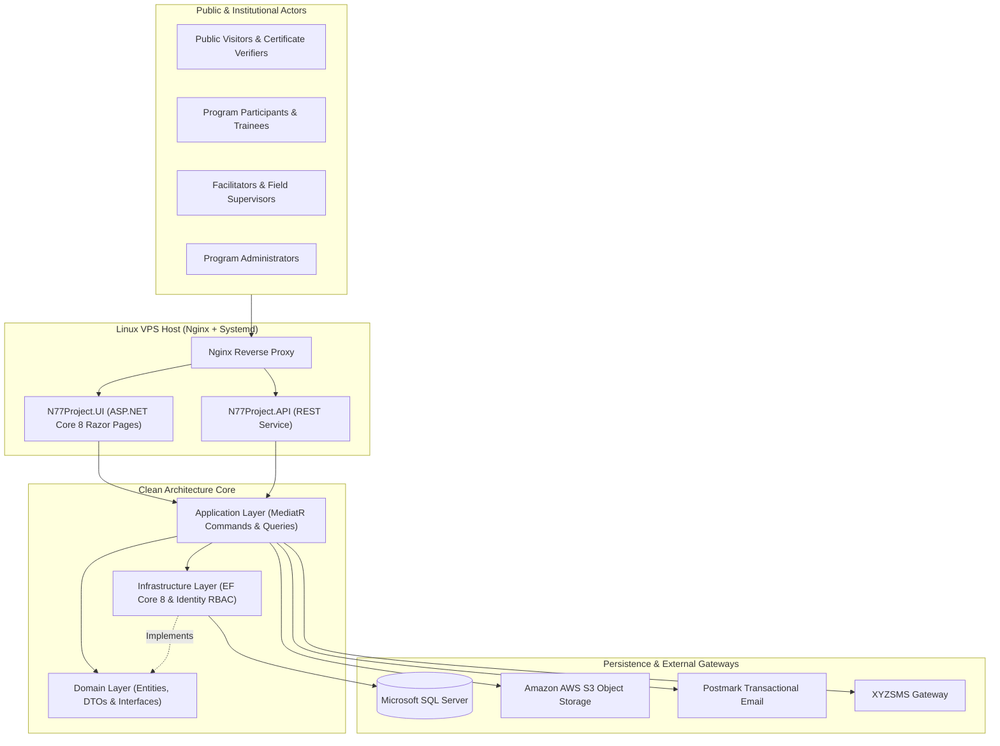

# N77PROJECT — Nationwide Capacity Building, CMS & Digital Credentialing Platform

[](https://dotnet.microsoft.com/)
[](#system-architecture)
[](#technology-stack)
[](#technology-stack)
[](#automated-deployment--zero-secret-governance)

An enterprise **Nationwide Training, Content Management, and Verifiable Credentialing Platform** engineered on **.NET 8 Clean Architecture and CQRS (`MediatR`)** for public-sector capacity-building programs across Nigeria's states and local government jurisdictions.

The platform unifies a **dynamic, multi-theme public institutional CMS** with a **secure role-based Training & Certification Management Information System (MIS)**—streamlining cohort scheduling, facilitator/participant onboarding, pre- and post-training competency exams, supervisory field evaluations, and QR-verifiable digital certificates.

---

## Architectural & Operational Highlights

- **Clean Architecture + CQRS (`MediatR`)**: Decoupled `Domain`, `Application`, `Infrastructure`, and `N77Project.UI` layers ensure maintainability, testability, and strict institutional governance.
- **Unified Institutional CMS + Training MIS**: Combines dynamic public portal theming (`SuperSetting`, `PageSection`, `Slider`, `BlogHome`) with deep operational workflows for nationwide cohorts (`Batch`, `Training`, `Attendance`, `Certificate`).
- **Automated Competency & Quality Assurance**: Built-in pre-test/post-test assessment grading (`TrainingTest`, `TestSheet`, `UserTest`) alongside daily trainee feedback and supervisory field compliance forms.
- **Self-Healing Linux `systemd` CI/CD Pipeline**: Automated GitHub Actions workflow publishes self-contained `linux-x64` binaries, injects encrypted secrets into `chmod 600` `.env` files, auto-detects free ports, configures UFW firewall rules, and performs automated HTTP health probes.

---

## System Architecture



---

## Solution Structure

```text
N77PROJECT/
├── .github/workflows/
│   └── deploy.yml                 # Automated CI/CD (Self-contained Linux build, SSH/SCP & health check)
├── src/
│   ├── Domain/                    # Core domain models, DTOs (incl. VerificationWebDto), and interfaces
│   ├── Application/               # MediatR CQRS command/query handlers & service registrations
│   ├── Infrastructure/            # EF Core DbContext, SQL Server migrations, and repositories
│   ├── API/                       # Companion REST Web API project
│   ├── AWS/                       # Amazon S3 cloud storage integration
│   └── PostmarkEmailService/      # Transactional email delivery engine
├── XYZSMS/                        # Bulk & transactional SMS integration client
├── UI/
│   └── N77Project.UI/             # ASP.NET Core 8 Razor Pages portal & CMS engine
│       └── .env.example           # Sanitized environment variable template
├── tests/
│   └── Test/                      # Automated test suite
├── deploy.sh                      # Idempotent systemd provisioning, port-discovery & health-probe script
└── N77PROJECT.sln                 # Visual Studio Solution
```

---

## Technology Stack

- **Framework**: C#, .NET 8, ASP.NET Core Razor Pages & Web API
- **Design Patterns**: Clean Architecture, CQRS (`MediatR`), Repository Pattern, ViewComponents
- **Database & ORM**: Microsoft SQL Server, Entity Framework Core 8
- **Security & Auth**: ASP.NET Core Identity (`AppUser`, `AppRole`), Role-Based Access Control (RBAC), `.env` Secret Isolation
- **Integrations**: Amazon AWS S3, Postmark Email API, XYZSMS API, `Rotativa.AspNetCore` (PDF Credential Generation)
- **DevOps**: GitHub Actions, Bash (`deploy.sh`), Linux `systemd`, UFW, Nginx

---

## Local Development Setup

### 1. Clone the Repository
```bash
git clone https://github.com/SirP-TechHub-0904/N77PROJECT.git
cd N77PROJECT
```

### 2. Configure Environment Variables
Copy the template `.env.example` to `.env` inside `UI/N77Project.UI/`:
```powershell
Copy-Item UI/N77Project.UI/.env.example UI/N77Project.UI/.env
```
Populate your local development connection string and API credentials inside `UI/N77Project.UI/.env`:
```ini
ConnectionStrings__AppConnection="Server=localhost;Database=N77_DevDb;Trusted_Connection=True;TrustServerCertificate=True;"
PostmarkSettings__ServerToken="your_postmark_token_here"
AwsConfiguration__AWSAccessKey="your_aws_access_key_here"
AwsConfiguration__AWSSecretKey="your_aws_secret_key_here"
```

### 3. Build, Migrate & Run
```bash
dotnet restore N77PROJECT.sln
dotnet build N77PROJECT.sln --configuration Release
dotnet ef database update --project src/Infrastructure --startup-project UI/N77Project.UI
dotnet run --project UI/N77Project.UI
```

---

## Automated Deployment & Zero-Secret Governance

Production releases are orchestrated via [`.github/workflows/deploy.yml`](.github/workflows/deploy.yml) and [`deploy.sh`](deploy.sh):
- Secrets are never stored in Git; production credentials are injected securely via GitHub Secrets (`DOTENV`) or preserved in `/var/www/n77/.env` (`chmod 600`).
- `deploy.sh` automatically manages `n77.service` under `systemd` and verifies HTTP `200`/`302` readiness post-deployment.

---

## Author

**Peter Emeka Onwuka**  
Chief Technology Officer & Enterprise Systems Architect  
- GitHub: [@SirP-TechHub-0904](https://github.com/SirP-TechHub-0904)  
- LinkedIn: [Peter Emeka Onwuka](https://www.linkedin.com/in/onwuka-peter-emeka)
